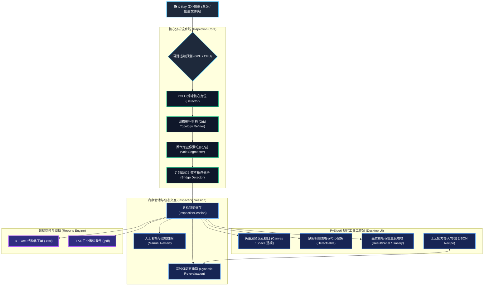

<div align="center">

# 🔬 BGA AI Inspector
### 工业级 BGA 芯片 X-Ray 探伤智能质检工作站
**面向半导体先进封装、高端 SMT 表面贴装与 PCB 组装产线的亚像素级自动化质检系统**

[](https://www.python.org/)
[-41CD52?logo=qt&logoColor=white)](https://wiki.qt.io/Qt_for_Python)
[](https://pytorch.org/)
[](https://opencv.org/)
[](https://www.ipc.org/)
[](https://microsoft.com)
[](LICENSE)

[功能特性](#-核心功能与工程亮点) •
[系统架构](#-系统架构与工作流) •
[快速上手](#-快速上手-quick-start) •
[操作指南](#-人机交互与快捷操作) •
[质检标准](#-四维质检算法与-ipc-判据) •
[报表体系](#-双模工业质检报告导出) •
[打包部署](#-工业二进制打包与部署)

</div>

---

## 📖 项目简介 (Overview)

**BGA AI Inspector** 是一款面向工业 4.0 制造场景的高精度自动化 X-Ray 探伤分析桌面工作站。系统集成了**深度学习目标检测**、**自适应网格拓扑重构**、**微气泡亚像素级形态学分割**及**多焊球空间拓扑间隙动态分析**技术。

针对 BGA（Ball Grid Array，球栅阵列）封装在回流焊接过程中常见的 **空洞超标 (Voiding)**、**连锡桥接 (Bridge)**、**少锡虚焊 (Insufficient Solder)** 及 **焊球缺失 (Missing Ball)**，提供从图像载入、ROI 裁剪、高精度推理、动态微调重算、人工复核闭环到双模报表（Excel / A4 PDF）存证的全流程工业级解决方案。

```
       [ 待测 X-Ray 图像 ] ───► [ 智能硬件感知引擎 (GPU/CPU) ]
                                            │
                                            ▼
 ┌────────────────────────────────────────────────────────────────────────┐
 │                      BGA 核心质检分析流水线                            │
 │                                                                        │
 │   ┌──────────────┐      ┌──────────────────┐      ┌────────────────┐  │
 │   │  焊球中心定位 │ ───► │ 自适应网格拓扑重构 │ ───► │  亚像素轮廓提取 │  │
 │   └──────────────┘      └──────────────────┘      └────────────────┘  │
 │                                                            │           │
 │   ┌──────────────┐      ┌──────────────────┐               ▼           │
 │   │ 连锡桥接判废  │ ◄─── │ 微气泡分割与面积 │ ◄───  四维缺陷矩阵分析   │
 │   └──────────────┘      └──────────────────┘                           │
 └──────────────────────────────────┬─────────────────────────────────────┘
                                    │
                                    ▼
       [ 矢量交互工作站 ] ◄──► [ 内存毫秒重算 ] ◄──► [ 导出标准质检报表 ]
```

---

## ✨ 核心功能与工程亮点 (Key Features)

### 1. 🎯 亚像素级四维缺陷全能筛查
* **气泡/空洞超标 (Voiding)**：结合自适应阈值与形态学轮廓算法，精准分割焊球内部微小气孔，精确计算空洞投影面积比。
* **连锡/桥接短路 (Bridge)**：基于阵列全局周期性与相邻焊球外轮廓最小间隙动态分析，毫秒级识别微米级粘连短路缺陷。
* **少锡/虚焊 (Insufficient Solder)**：自动计算全局焊球平均几何半径与面积，自适应比对缩减率，捕捉锡膏不足引发的可靠性隐患。
* **漏焊/掉球 (Missing Ball)**：内置拓扑网格智能重构算法（Grid Topology Refiner），自动补齐芯片阵列并标识缺失焊盘。

### 2. ⚡ 纯内存毫秒级动态重算 (Dynamic Re-evaluation)
* 调参无需重新运行模型：在右侧面板拖动阈值滑块或输入精确数值，系统基于内存中已提取的特征矩阵进行**微秒至毫秒级重判**。
* 视口标注、缺陷列表、统计看板与底部缩略图卡片全链路无缝联动。

### 3. 🔍 工业防眩光矢量视口与极速透视
* **无级平滑缩放**：基于 `QGraphicsView` 架构，最高支持 1600% 无级平滑抗锯齿放大，支持数千万像素工业底图极速漫游。
* **长按空格键极速透视**：按住空格键瞬间隐藏所有色彩标注，裸露纯净 X-Ray 灰度底图，松开即刻恢复，便于人眼对比核实。
* **双击表格准星靶心锁定**：双击明细表格任意行，视口即刻居中并以高亮激光电光青靶心锁定焊球位置。

### 4. 🛡️ 人工复核与误检排除闭环 (Manual Review Loop)
* **双轨容错机制**：支持质检员针对争议焊点或桥连进行一键“排除误检 / 撤销恢复”操作。
* **看板与审计联动**：看板统计区分“初检不良数”与“最终有效不良数”，排除记录自动归档并呈现在报告中，实现可追溯的质量闭环。

### 5. 📋 工艺配方管理 (Recipe Management)
* **参数一键固化**：支持将当前调整好的工艺阈值【保存为默认】或一键【恢复出厂标准】。
* **JSON 配方导入导出**：支持导出专属于某款芯片/产线的工艺方案文件（如 `Recipe_BGA_153.json`），换线时一键导入即刻生效。

### 6. 📄 工业双模质检报表自动生成
* **结构化 Excel 工单 (.xlsx)**：自动输出多 Sheet 报表，涵盖批次元数据、汇总良率、每个焊球的座标、半径、空洞比及复核审计明细。
* **合规 A4 工业质检单 (.pdf)**：通过 ReportLab 生成包含原图标注、缺陷列表、大号 PASS/REJECT 检验结论章及工程师签字栏的标准化文书。

### 7. 🔌 智能硬件感知与热替换升级
* **双引擎自适应**：智能探测宿主机算力，支持 NVIDIA CUDA TensorRT/FP16 显卡加速；在核显或无显卡机台上自动平滑降级为多核 CPU 模式，100% 杜绝崩溃。
* **外部模型秒级热更**：启动时优先加载根目录 `backend/best.pt`，产线更新算法无需重新编译打包软件。

---

## 🏗️ 系统架构与工作流 (Architecture)



---

## 🎨 工业级色彩规范体系 (Color System)

系统严格遵循工业人机工学色彩规范（统一于 [`desktop_app/ui/styles/color_palette.py`](file:///d:/AAAAA/BGA/BGA/desktop_app/ui/styles/color_palette.py)）：

| 元素类型 | 语义定义 | 代表色彩 | HEX 代码 | 说明 |
| :--- | :--- | :---: | :---: | :--- |
| **正常焊球** | PASS 检验合格 | 翡翠绿 | `#10b981` | 极细环形标注，不遮挡焊球原貌 |
| **超标空洞** | Voiding NG | 亮橙色 | `#ff7a00` | 醒目冷暖对比，标示超标气孔轮廓 |
| **工艺微气泡** | Voiding PASS | 电光青 | `#00f2fe` | 符合 IPC 容差的微量良性气泡 |
| **连锡桥接** | Bridging NG | 警戒鲜红 | `#ef4444` | 连接线与双球高亮外框提示短路风险 |
| **少锡虚焊** | Insufficient NG | 电光紫 | `#a855f7` | 焊球体积缩减超过设定门限 |
| **靶心定位** | Focus Target | 激光纯金 | `#ffe600` | 表格双击聚焦时最醒目的同心圆靶心 |
| **人工复核合格**| Manual PASS | 科技青蓝 | `#06b6d4` | 经质检员核准排除误检的焊点状态 |

---

## 🚀 快速上手 (Quick Start)

### 1. 环境依赖要求
* **操作系统**：Windows 10 / 11 (64-bit)
* **Python 版本**：Python 3.9 - 3.11 (推荐使用 Conda 隔离环境)
* **显卡支持**：支持 CUDA 11.8+ 的 NVIDIA 显卡（可选，无显卡将自动降级为多核 CPU 运行）

### 2. 源码克隆与依赖安装
```bash
# 克隆本仓库
git clone https://github.com/your-username/BGA-AI-Inspector.git
cd BGA-AI-Inspector

# 创建并激活 Conda 虚拟环境
conda create -n bga-env python=3.10 -y
conda activate bga-env

# 安装 PyTorch (建议根据自身显卡 CUDA 版本安装对应的 PyTorch)
# 示例：CUDA 11.8 版本
pip install torch torchvision --index-url https://download.pytorch.org/whl/cu118

# 安装工作站专属核心依赖
pip install -r requirements_desktop.txt
```

### 3. 模型权重准备
将训练好的 YOLO 模型权重文件放置于 `backend/` 目录下（默认命名为 `best.pt`）：
```text
BGA/
└── backend/
    └── best.pt    <-- 放置于此处
```

### 4. 启动工作站
可以直接运行 Python 脚本或双击根目录的一键启动脚本：
```bash
# 方式 A：通过命令行直接运行
python desktop_app/main.py

# 方式 B：在 Windows 资源管理器中双击运行
run_desktop_app.bat
```

---

## ⌨️ 人机交互与快捷操作 (Keybindings)

工作站内置了符合工业质检现场高效操作的快捷键体系：

| 操作手势 / 快捷键 | 对应动作 | 详细说明 |
| :--- | :--- | :--- |
| **长按【空格键】(Space)** | **极速透视原图** | **按住瞬间隐去所有彩色标注，露出纯净灰度底图；松手瞬间恢复** |
| **双击明细表格行** | **准星靶心锁定** | **视口瞬间居中放大，并以激光纯金圆环准星高亮锁定该缺陷球** |
| **鼠标滚轮** | 画布平滑缩放 | 以鼠标当前光标为锚点，实现 10% ~ 1600% 无级平滑缩放 |
| **鼠标左键 / 右键拖拽** | 视口平移 (Pan) | 按住鼠标拖动即可在超高分辨率图像中自由漫游 |
| **键盘【←】/【→】** | 批量切图 | 批量质检模式下，直接切换上一张 / 下一张图像并跟随显示 |
| **键盘【Esc】** | 恢复隐藏标注 | 一键恢复所有在视口中被手动消隐的缺陷图元 |
| **双击画布空白处** | 1:1 像素复位 | 快速恢复为 100% 原始分辨率比例查看 |
| **鼠标悬停焊球** | 悬停 HUD 卡片 | 毫秒级浮现焊球编号、坐标、等效半径与实测气泡比 |

---

## 📏 四维质检算法与 IPC 判据 (Inspection Standards)

```
                       IPC-A-610 BGA 缺陷判定准则
  ┌──────────────────────────────────────────────────────────────┐
  │                                                              │
  │   1. 空洞率 (Voiding Rate)      S_void / S_ball <= 15%~25%   │
  │   2. 焊球少锡 (Insufficient)    R_ball / R_mean >= 75%~80%   │
  │   3. 连锡桥接 (Bridging)        Min_Gap > 0 且无粘连通路     │
  │   4. 焊盘缺失 (Missing Ball)    阵列网格无空置焊盘缺失       │
  │                                                              │
  └──────────────────────────────────────────────────────────────┘
```

1. **空洞缺陷 (Voiding)**
   * **判据机理**：根据 IPC-A-610 工业标准，单一或复合气泡面积占比大于设定值（默认 `15.0%` 或 `25.0%`）时判定为 NG。
   * **算法流程**：对焊球内部 ROI 进行局部灰度对比度均衡 ➜ 动态 Otsu 阈值多阶分割 ➜ 轮廓噪点滤除 ➜ 像素级面积比积分。
2. **连锡/桥接短路 (Bridging)**
   * **判据机理**：相邻焊球之间发生物理焊锡粘连或间隙严重不足。
   * **算法流程**：构建焊球阵列 Delaunay 三角剖分与局部近邻拓扑图 ➜ 探测相邻焊球连通域通道 ➜ 触发双球红色联动警戒标记。
3. **少锡/虚焊 (Insufficient Solder)**
   * **判据机理**：钢网印刷漏锡导致成球体积过小。
   * **算法流程**：统计全阵列焊球等效半径均值 $R_{mean}$，当实测半径 $R < (1 - \alpha) \times R_{mean}$ 时标记为体积缩减超标。
4. **漏检补齐与缺失焊盘 (Missing Ball)**
   * **算法流程**：基于阵列周期拓扑投影分析，重构规则网格点阵；当对应周期节点无检测候选球时，标识该处焊盘为掉球缺失。

---

## 📑 双模工业质检报告导出 (Reports)

工作站内置开箱即用的两套出厂报表引擎：

### 1. 结构化 Excel 工单 (`.xlsx`)
* **检测概要 Sheet**：记录工单编号、芯片料号、测试耗时、设备环境、整板结论、良品率及分类不良统计。
* **焊球明细 Sheet**：包含全板所有焊球的中心座标 $(X, Y)$、等效半径、气泡占比、桥接状态、AI 原始判定及人工复核备注。

### 2. A4 工业级 PDF 质检合格证书 (`.pdf`)
* 采用 ReportLab 矢量引擎排版，符合 ISO/TS 质量追溯规范。
* 包含原图与带标注检测结果图、缺陷分布汇总表、大号 PASS / REJECT 印章与工程师审核签章栏。

---

## 📦 工业二进制打包与部署 (Deployment)

针对产线无 Python 环境的工控机台，系统已针对 PyInstaller 进行深度封装适配：

```bash
# 执行根目录下的自动打包脚本
build_binary_package.bat
```

打包完成后，`dist/BGA_AI_Inspector` 目录即可独立分发。部署结构如下：
```text
BGA_AI_Inspector/
├── BGA_AI_Inspector.exe        # [核心主程序] 双击即可运行
├── backend/                    # [外部模型目录]
│   └── best.pt                 # 产线可在此热替换最新模型
├── assets/                     # 窗口图标与静态资源
└── _internal/                  # 二进制底层库与 PyTorch 运行环境
```

---

## 📂 项目目录结构 (Directory Layout)

```text
BGA/
├── assets/                     # 系统静态图标 (app_icon.ico 等)
├── backend/                    # 深度学习模型、YOLO 管道与核心算法
│   ├── best.pt                 # 核心检测权重
│   ├── bga_pipeline.py         # 四维质检综合分析流水线
│   ├── bga_void_seg.py         # 亚像素微气泡分割算法
│   ├── bga_bridge_detect.py    # 桥连短路拓扑分析算法
│   ├── bga_insufficient_detect.py # 少锡虚焊半径缩减算法
│   └── models/                 # 网络结构定义
├── desktop_app/                # PySide6 工业工作站前端源码
│   ├── main.py                 # 客户端程序启动入口
│   ├── app_config.py           # 工作站配置与 JSON 配方管理
│   ├── core/                   # 硬件嗅探、线程池与质检会话
│   │   ├── hardware_sniff.py   # GPU / CPU 智能自适应感知
│   │   ├── inspection_manager.py # 质检内存会话与重算调度
│   │   └── worker_thread.py    # 后台异步并发推理线程
│   ├── ui/                     # UI 视图层
│   │   ├── main_window.py      # 工作站主窗口
│   │   ├── panels/             # 控制面板、参数面板、缺陷表格、缩略图栏
│   │   ├── viewports/          # 交互式矢量画布、焊球图元、HUD 悬停探针
│   │   └── styles/             # 工业暗黑 QSS 皮肤与统一色彩系统
│   ├── reports/                # 质检工单生成器 (Excel & PDF)
│   └── utils/                  # 辅助工具模块
├── docs/                       # 详细工程技术手册与用户指南
├── packaging/                  # PyInstaller 工业打包规范 (.spec)
├── requirements_desktop.txt    # 核心运行依赖清单
├── run_desktop_app.bat         # 智能环境探测与快速启动脚本
└── build_binary_package.bat    # 一键二进制打包脚本
```

---

## 🗺️ 发展路线 (Roadmap)

- [x] 基于 PySide6 的工业级暗黑风工作站与无级放大视口
- [x] 四维缺陷筛查（空洞、桥连、少锡、漏检补齐）
- [x] 纯内存毫秒级动态重算与阈值微调
- [x] 人工复核误检消除双轨闭环与 Excel/PDF 报表联动
- [x] 工艺配方 JSON 导入、导出与出厂默认值固化
- [x] 智能感知 GPU/CPU 双引擎无缝切换
- [ ] 支持工业 GigE / USB3 Vision 工业相机直接视频流采集
- [ ] 基于 TensorRT C++ 原生推理后端进一步压榨推理节拍至 < 15ms
- [ ] 接入 MES (制造执行系统) 自动化数据库上传与 SECS/GEM 通讯协议

---

## 🤝 贡献与反馈 (Contributing)

欢迎提交 Issue 和 Pull Request 来完善本系统：

1. Fork 本仓库并新建分支 (`git checkout -b feature/AmazingFeature`)
2. 提交您的修改 (`git commit -m 'feat: Add some AmazingFeature'`)
3. 推送至您的分支 (`git push origin feature/AmazingFeature`)
4. 开启一个 Pull Request

---

## 📄 开源许可证 (License)

本项目基于 [MIT License](LICENSE) 协议发布，欢迎用于学术研究与工业制造场景。

---

<div align="center">
  <sub>Designed for Industrial Excellence · Built with PySide6 & PyTorch</sub>
</div>
